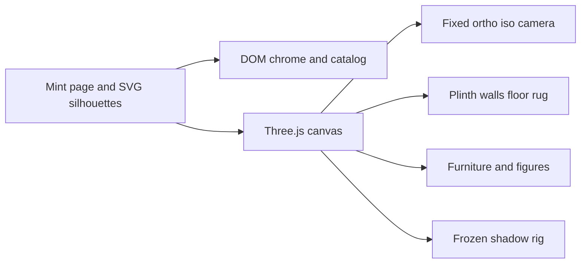

# Isometric Room Editor

Greenfield app in [d:\ThreejsEditor\3D Dash Board](d:\ThreejsEditor\3D Dash Board). The finish line is a side-by-side match with the reference: periwinkle scalloped walls, cream tile floor, sage rug, four posed figures, cat, and the exact chrome clusters. A scene that only “looks isometric and cozy” is not done.

The reference shows **two walls** meeting at an inside corner (windows on the left wall, bookcase on the right wall), open toward the viewer, on a thick rounded olive plinth. That is the shell to build. A third wall would hide the open front and break the silhouette.

## Stack

Vite + TypeScript + Three.js only. No model/texture/HDRI/sprite/icon-font/audio imports. UI is DOM + inline SVG so the pills can ease, spring, and stagger without fighting the WebGL camera. The diorama is one WebGL canvas behind that chrome.

## Scene layout

Locked palette in `src/theme.ts`, sampled from the reference and then tuned in the browser: mint page, saturated periwinkle walls, cream tiles, sage rug, warm wood, terracotta, lamp green, clothing colors from the four figures. No golden-hour grade, no env map, roughness-1 materials or custom shaders so surfaces stay matte.

Camera in `src/scene/camera.ts`: orthographic, yaw 45°, elevation about 30° (tuned until the plinth and corner match the reference). Zoom is a short list of distances (`Far`, `Default`, `Near`, and one tighter step). The label updates with the step. The angle never changes. Shadow frusta do **not** follow zoom.

## Stable light

`src/scene/lights.ts`

- One soft window directional, aimed from the left windows, plus a warm lamp point/spot.
- Shadow cameras are fit once to the room bounds, not the view. Map size 4096, bias fixed, `shadow.autoUpdate = false` after the first clean render of a lighting state.
- Day/night only crossfades intensities and wall/glass tint (~350ms). When the tween ends, shadows render **once** and freeze. They must not crawl during the fade or when zoom changes.
- Contact-tight grounding is a separate radial-gradient shader disc under every leg, pot, book, person, and the cat (`src/scene/contactShadow.ts`). That disc is what makes feet and pots sit; the baked map supplies the broader soft shadow.
- Lamp warmth on the wall and cabinet top is an additive soft blob, parented to the lamp, so it does not depend on an HDRI or real GI. The shade is a green shell with a brighter bulb inside.

## Room shell

- `src/scene/room/plinth.ts`: thick squircle/rounded-rect base, olive, big soft drop shadow on the page (a wide blurred disc under the plinth, not a live shadow-map cast onto an infinite ground).
- `src/scene/room/walls.ts` + `src/shaders/wallpaper.ts`: two wall slabs with thickness and a baseboard. Scallop wallpaper is a shader in each wall’s own axes (along-wall, up), with U origin shared at the corner so the fish-scale repeat continues around it. Matte, no specular lobe.
- `src/scene/room/floor.ts`: tiles from world XZ, constant module, thin even grout via `fract`. Axis-aligned in plan so the iso view shows diamonds. No texture image.
- `src/scene/room/rug.ts`: sage rounded rectangle, slight thickness, stitch border (small dashes or a border shader), own contact shadow, placed left of center as in the reference.

## Props and figures, all code meshes

Each object is a builder that returns a `Group` plus a floor footprint for grid snap. Shared parts live in `src/scene/parts/` (wood shader with soft stripe variation, book, pot, leaf, cup, cushion).

Detail bar for the places the eye lands:

- Windows: wood frame, muntins, sill, pale mint glass, light card behind the glass.
- Bench: thick seat, short legs, lower shelf.
- Dried grass: each blade its own bent curve, two terracotta pots.
- Easel, stretcher canvas, a few paint marks. Woman: long hair, beret, brown dress, weight on one leg, one arm up toward the canvas. Hands are separate geometry.
- Bookcase: thick shelves, individual books (height, spine color, a few leaning), two different boxes on top.
- Oval frame: outer frame, mat, and a simple picture, not an empty ring.
- Cabinet: green shade, visible warm bulb, small plants, plate with food, books on the open shelf, dark utensil pot with separate sticks, two-slot outlet.
- Round table: thick top, single pedestal, two plants with different leaves. Girl in yellow sweater and blue pants on a stool, both hands on a cup.
- Drawing boy: on his stomach, separate sheet with marks, pencil meeting the page, stacked books with offset spines.
- Reading boy: cream sweater, small green book with cover and page block, hands closed on it.
- Cat: curled volume, ears, wrapped tail, orange/white patches that follow the body, short-fur shader (view-stable noise, not a photo).

Cloth gets a few hem and elbow folds. Faces stay illustrated: dot eyes, small blush, no photoreal skin. Poses are static. Motion is not a character loop.

## Editor behavior

`src/editor/state.ts` holds the item list, selection, tool, zoom step, day/night, prop visibility, mute, and an undo stack.

- Catalog (`src/ui/catalog.ts`): the reference grid (search, two tools, then the rounded icon cells). Search filters by name. The two tool icons are category filters; icons stagger out and back in. Empty filter state is a designed blank, not a missing render. Selected cell stays highlighted.
- Place: chosen item fades and scales in onto the grid, with a stable contact shadow.
- Move tool: drag or arrow keys, snap to grid. Grid pill shows or hides the overlay.
- Delete: lift and fade. Undo restores the command.
- Eye: fades non-essential scatter (small plants, loose books, food, utensils, picture) and leaves shell, major furniture, people, and cat.
- Volume: icon toggles a muted glyph only.
- Record: visual “armed” state only. No capture, no camera path.
- Camera pill: one still PNG from the canvas. Home returns zoom to Default and clears selection. Menu and help are small popovers; settings only exposes shadow-map size if needed for the machine.

UI motion in `src/ui/motion.ts`: load stagger, hover/press spring (~180ms), interruptible tweens. No dolly, no shot list.

Chrome placement matches the reference: top-left menu / camera / home / undo; top-right minus, “Default”, plus, then eye, delete, record, help, settings; left catalog rail; bottom-center grid, move, day/night, volume. White pills, soft shadows, squircle icon buttons, hand-written SVG strokes in `src/ui/icons.ts`. Page background in `src/ui/backdrop.ts`: mint field, large muted mushroom and plant silhouettes, small bottom sprigs, faint corner frame.

## File map

- [index.html](index.html), [src/main.ts](src/main.ts), [src/style.css](src/style.css)
- [src/theme.ts](src/theme.ts), [src/scene/createScene.ts](src/scene/createScene.ts)
- [src/scene/room/](src/scene/room/), [src/scene/props/](src/scene/props/), [src/scene/characters/](src/scene/characters/)
- [src/shaders/](src/shaders/), [src/editor/](src/editor/), [src/ui/](src/ui/)

Default scene is one data list in `src/scene/defaultScene.ts` so reset and undo can rebuild the reference layout exactly.

## Verification loop

Run the Vite app and compare against the reference after each pass. Order:

1. Camera, plinth silhouette, wall corner, wallpaper repeat, tile module, rug.
2. Windows, bench, bookcase, cabinet, lamp glow, table.
3. Four figures and the cat, then grass, books, utensils, outlet, frame.
4. Every toolbar cluster: alignment, icon shapes, selected and empty states.
5. Zoom steps, day/night, place, nudge, delete, eye. Confirm the still frame does not shimmer.

Fix and recheck before calling the pass done. Extra detail goes to floor, rug, bookcase, windows, lamp, plants, the four figures, and the cat until those read as the same scene as the reference.
